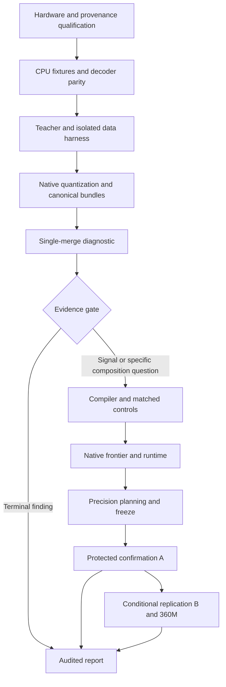

# Counterexample-guided operator coalescing: project specification

**Date:** 2026-10-27. **Status:** proposed design for review; implementation and experimental confirmation have not started.

**Source:** [research blueprint](../../blueprint.md), preserved at commit `9846751`, SHA-256 `bf969fb75ba81778481504f4da951575cd5c19220da91872a9986b9a7cfcbd0b`.

**Companions:** [critical analysis](../../analysis/2026-10-27-blueprint-review.md) and [implementation plan](../plans/2026-10-27-cgoc.md).

This document translates the blueprint into implementation contracts. The blueprint remains the research rationale and reference ledger. Requirements labeled **R01–R26** below are the acceptance contract; engineering decisions identified as proposals have not been represented as user-approved scientific choices. If a later implementation changes the teacher, population, objective, comparison, or accounting boundary, it must record a methodological amendment. The present deliverable is documentation, not authorization to run the entire study.

## 1. Intent, approaches, and scope

**R01 — Research question.** Determine whether candidate-specific counterexamples help select which complete nonlinear FFNs can share stored weights, beyond ordinary downstream KL, similarity grouping, causal distillation, hard-example training, and strong quantization. Measure both attribution at matched bank architecture and practical performance at an actual payload ceiling. A valid negative or inconclusive finding completes the study.

The beneficiaries are developers deploying local language models with storage or resident-memory constraints. The primary teacher is `HuggingFaceTB/SmolLM2-135M`; `HuggingFaceTB/SmolLM2-360M` is conditional replication, not an initial dependency. Preserve the original base tokenizer and natural-language evaluation. There is no instruction/chat template.

| Approach | Benefit | Cost / reason for disposition |
|---|---|---|
| Diagnostic-first static FFN bank, then gated compiler | Isolates measurement validity and the extra information in active probes before expensive search | Recommended here; may terminate before producing a compiler if the diagnostic is uninformative |
| Build the whole compiler and baseline suite immediately | Exercises joint compression earlier | Defers discovery of broken gradients, unusable kernels, and ineffective ranking; unnecessary implementation cost before evidence |
| Dynamic routing, attention sharing in CGOC, or external memory | Potentially changes the storage floor | Different causal questions, state semantics, and accounting; excluded from this study |

The recommendation follows the blueprint's explicit sequence. It is a proposed implementation approach, not a choice already confirmed in conversation. Whole-block sharing remains an eligible **baseline**, even though CGOC itself initially shares only FFNs.

Goals: faithful local execution, compact canonical storage, discriminating controls, equal information access, traceable construction cost, protected inference, and a reproducible report. Anti-goals: claiming global equivalence, novelty from renaming prior art, interpreting non-significance as parity, hiding failed runs, or claiming a latency win from parameter arithmetic.

No dynamic controller, new tokenizer, external teacher API, repair atlas, knowledge store, new pretraining, custom Metal kernel, cloud accelerator, paid service, or benchmark answer correction is part of the core. No 10–100× milestone is promised. Coding, multilingual ability, instruction following, alignment, and frontier reasoning are outside the supported population.

## 2. Global constraints

The following exact constraints also appear in the plan:

- Work on the current branch; do not create a worktree or switch branches for this project unless the user later requests it.
- Use one local Apple Silicon machine; no paid API, remote accelerator, or external teacher service is a core dependency.
- Primary teacher: `HuggingFaceTB/SmolLM2-135M`; conditional scale teacher: `HuggingFaceTB/SmolLM2-360M`; `trust_remote_code=false`.
- Scientific execution: PyTorch FP32 on validated MPS or explicitly labeled CPU; numerical references: CPU FP64; deployment comparisons: the same validated MLX runtime.
- Primary context: 512 tokens; reported KL temperature: 1.0; initial head-position chunk: 32; accumulation target: 8192 valid predicted tokens per update.
- Initial complete bank: `K=15`, FFN residual rank `8`, residual scale `1.0`; original depth, attention, norms, tokenizer, RoPE, and embedding/head tying are preserved in the primary mechanism track.
- Initial payload anchor: a validated `K=15`, rank-8, 4-bit, group-64 bank bundle with BF16 residuals; use actual complete file sizes, not a parameter estimate.
- No protected outcomes may influence fitting, search, calibration, tuning, exclusions, or selection; every protected evaluation verifies an immutable freeze.
- Unsupported operations, missing measurements, and infeasible budgets are explicit statuses with reasons; they are never replaced by invented values or silent fallbacks.
- Do not commit raw datasets, downloaded checkpoints, credentials, large generated artifacts, or restricted third-party source code.

**R02 — Platform qualification.** Discover architecture, macOS, Python, physical and available memory, pressure/swap, disk, Xcode tools, and backend operation support. Native Python 3.11 or 3.12 is a starting candidate, not a required untested pin. Resolve stable compatible wheels, then lock exact versions, hashes, platform, upstream commits, and patches after tiny operation tests. No OS upgrade, nightly dependency, Rosetta, or allocator-limit removal is implied. Import MLX lazily so CPU correctness tests can run without Apple hardware. Hardware-specific tests report skipped-with-reason separately from passes.

The initial memory allocation target is at most about 60% of physical memory, further bounded by measured available memory and pressure. Measure activation, optimizer, conversion, SVD, and reconstruction peaks. Reducing chunks, recomputing activations, and scheduling sequentially preserve semantics; shortening the primary context changes the workload and needs an amendment. Resource budgets must be finite and explicit before work consuming them starts. There is no default unlimited run.

## 3. System boundaries and artifacts

**R03 — One local experiment harness.** Use the `poc` Python package and a filesystem, with one active training/conversion job. Each method uses the same configuration validator, input manifests, decoder interface, evaluator, byte accounting, recorder, and analysis. Backend code is isolated from dataset policy and statistics.



Use these module boundaries (the plan assigns creation tasks):

| Responsibility | Files |
|---|---|
| CLI, typed contracts, strict config, cost budgets | `poc/__main__.py`, `cli.py`, `contracts.py`, `config.py`, `budget.py` |
| Run identity, append-only events, resumable checkpoints | `poc/records.py`, `checkpoint.py` |
| Environment and asset qualification | `poc/doctor.py`, `assets.py` |
| Data roles, duplicates, windows, public task parsing | `poc/data/{__init__,manifest,dedup,windows,access,benchmarks}.py` |
| Teacher loading and mathematical model adapters | `poc/teacher.py`, `runtime/{__init__,torch_decoder,mlx_decoder}.py` |
| Canonical bank, loss calculation, fitting | `poc/bank.py`, `losses.py`, `train.py` |
| Probes, trials, diagnostic, partition search | `poc/probes.py`, `merge.py`, `diagnostics.py`, `compiler.py`, `synthetic.py` |
| Comparison methods | `poc/methods.py`, `baselines/{__init__,rrt,cka,hard_examples,basis,sharvet,prune,reconstruct,precision_search}.py` |
| Artifact format, native conversion, quantization | `poc/bundle.py`, `export.py`, `quantize.py` |
| Metrics, runtime, statistics, protocol, reporting | `poc/evaluate.py`, `bench.py`, `stats.py`, `protocol.py`, `report.py`, `reproduce.py` |

Proposal: replace the blueprint's broad `data.py` with the focused package above; standardize `evaluate.py` and `tests/test_stats.py` rather than the alternate names in individual WPs. Do not introduce a second package nesting the existing repository. Commands are thin adapters to these modules.

## 4. Shared types and decoder contract

**R04 — Typed, unambiguous boundaries.** Use frozen dataclasses for records and protocols for methods. `Tensor` below denotes the active backend tensor; the scientific implementation uses `torch.Tensor`, the native implementation uses MLX arrays. Do not accidentally convert live autograd tensors through NumPy. Shapes and masks are validated at interfaces.

```python
@dataclass(frozen=True)
class Batch:
    input_ids: Tensor          # int64 [B,S]
    attention_mask: Tensor     # bool [B,S]
    target_mask: Tensor        # bool [B,S-1]
    positions: Tensor          # integer [B,S]; absolute within this model context
    document_ids: tuple[str, ...]
    cluster_ids: tuple[str, ...]

@dataclass(frozen=True)
class Boundary:
    u: Tensor                  # [B,S,d], post-attention, before norm2/FFN
    batch: Batch               # preserves targets, valid positions and identities
    depth: int                 # original zero-based depth
    model_digest: str          # exact state that produced this prefix

class DecoderAdapter(Protocol):
    def final_hidden(self, batch: Batch, *, cache: CacheState | None = None) -> Tensor: ...
    def readout(self, hidden: Tensor) -> Tensor: ...
    def logits(self, batch: Batch, *, cache: CacheState | None = None) -> Tensor: ...
    def prefix_boundary(self, batch: Batch, depth: int) -> Boundary: ...
    def ff_residual(self, boundary: Boundary, operator: FFNOperator | None = None) -> Tensor: ...
    def suffix_hidden(self, after_ffn: Tensor, boundary: Boundary) -> Tensor: ...
    def suffix_logits(self, after_ffn: Tensor, boundary: Boundary) -> Tensor: ...
    def score_continuations(self, requests: Sequence[ContinuationRequest]) -> list[ContinuationScore]: ...
    def manifest(self) -> ModelManifest: ...
```

`FFNOperator` is a callable mapping normalized `[...,d]` inputs to `[...,d]` outputs. `CacheState` owns a cache per executed original depth plus position/length metadata; it is never a bank-level cache. `ModelManifest` describes model config, owner/use sites, tokenizer digest, checkpoint digest, dtype, and backend. `ContinuationRequest` contains prompt IDs, continuation IDs, boundary policy digest, and item ID; `ContinuationScore` contains summed log likelihood and scored token count. `score_continuations` uses the same masking/readout logic as natural-text evaluation.

`prefix_boundary(batch,l)` runs blocks before `l` and attention at `l`; `ff_residual` returns `u + F(norm2_l(u))`; `suffix_hidden` runs blocks `l+1..L-1` and final norm. At `l=L-1`, the suffix is final norm only. `suffix_logits` is readout of that result. Full-sequence boundaries do not accept an inference cache. `final_hidden` and `logits` update a supplied cache once per call; calling both on the same token with the same mutable cache is invalid.

The candidate suffix input remains differentiable even with frozen suffix parameters. Teacher target branches use no-grad; the candidate-through-teacher-suffix branch must not. Student-state probes detach the current candidate prefix, then feed that **same boundary** to both FFNs through the **teacher** suffix. These target predictions are not mislabeled as the teacher's natural predictions.

**R05 — Causality and positions.** Right-pad teacher-forced batches; real EOS remains a target even when EOS equals padding ID. Target index `j` scores input token `j+1` using hidden position `j`. The final input position has no next-token target. Position offsets are identical across methods. Proposal: independently recomputed sampled and WikiText rolling windows reset model position IDs to `0..S-1`, while retaining their original document offsets in `WindowRecord`. A cropped context is not represented as an uncomputed full-document prefix; long source documents therefore do not silently exceed the teacher's positional range. Incremental generation continues the cached context's positions; parity tests include nonzero continuation offsets. Donor alignment uses the model-context position and records source spans separately. Never concatenate documents through attention.

Initial native cached generation is batch one. Mixed prompt lengths are checked by independent requests against batched teacher-forced outputs; unsupported padded cache batching fails explicitly. Full versus cached logits must agree for teacher, compact bank, quantized bank, whole-block baseline, and reduced-depth variants on each supported path. RoPE and cache slots follow actual execution order while a separate original-depth map identifies surviving weights in pruning baselines.

## 5. Representation, initialization, and numerics

**R06 — Canonical bank ownership.** Each gate/up/down matrix is `[out,in]`. At depth `l`, execute `linear(x,W_bank[c(l)]) + linear(linear(x,A_l),B_l)` with scale exactly 1. `A` is `[r,in]`, `B` is `[out,r]`. The bank owns tensors once; wrappers own integer indices and private residuals only. Rank zero allocates no factors. All depths, including singleton groups, retain the chosen rank in matched-bank comparisons. The teacher itself has no residuals.

Keep attention, per-depth norms, tokenizer, original depth, positions, head tying, and masks unchanged for M/R/RC/CKA/H. Optimizers see unique owners once and gradients sum over uses. Deployment must not fold residuals into per-depth dense weights. Dense expansion exists only as a diagnostic, with its own measured storage if ever timed.

For hidden width `d`, FFN width `m`, depth `L`, bank size `K`, and uniform rank `r`:

`P = P_nonFFN + 3*K*d*m + 3*L*r*(d+m)`.

Sharing does not remove depth executions or KV-cache entries. Approximate FFN work is `6*L*d*m + 6*L*r*(d+m)` operations per token, excluding attention/head/elementwise costs.

**R07 — Initialization and limiting cases.** A merge tries each of the two existing parent bank operators as medoid, not an unaligned arithmetic average. For every affected depth, initialize residuals from CPU SVD of `teacher_weight - proposed_bank_weight`, with symmetric square-root singular-value factors. Compare medoids on the same `fit` activation reconstruction records; ties use canonical group order. If the difference is zero, use seeded small random A and zero B so learning can start. Full-rank reconstruction is a CPU reference, not an assumed affordable deployment rank.

Fixture requirements: eight depths, width 32, intermediate width 64, exact reuse map `[0,1,0,0,1,1,0,1]`, independently permuted hidden FFN neurons, an exact unpermuted oracle bank, independent-FFN no-reuse control, nondegenerate readout, readout-nullspace example, planted missing-coordinate counterexample, and nontransitive/joint-substitution failures. The exact oracle must pass parity; the heuristic is tested on recoverable planted cases without promising recovery of a unique partition from finite samples.

**R08 — Loss and gradients.** Report full-vocabulary teacher-to-student KL in nats at temperature 1.0. Use FP32 log-softmax/reductions on accelerators, CPU FP64 reference and scalar aggregation. Retain raw small negative values; only presentation may clamp within a premeasured identity tolerance. Larger negatives, NaNs, or infinities invalidate the run. The global objective is `KL(T,M) + alpha*NLL(M)` with initial alpha 0.1 and common development alternatives 0 and 1.

Project over prediction positions in chunks of 32 initially, preserving every vocabulary class. Accumulate sums divided by the **whole update's valid-target count**, including ragged chunks and microbatches. Do not use top-k teacher distributions, logit MSE, or probability clipping as replacements. Empty-target batches generate an explicit skipped record and no optimizer update; empty evaluation populations are errors.

For training, retain upstream hidden graph `H`, create detached leaf `Z`, backpropagate every readout chunk into `Z` and any trainable head owner, then backpropagate `Z.grad` through `H` once. Zero gradients once per update. This sums both paths of tied embedding gradients. Local suffix objectives use the same readout mechanism with the teacher suffix graph retained/recomputed. Verify against unchunked loss/gradients, including tied weights, final ragged chunks, masks, NLL, and multiple microbatches.

**R09 — Shared fitting schedule.** Start with AdamW bank LR `1e-4`, residual LR `3e-4`, betas `(0.9,0.95)`, clipping 1, 5% warmup, cosine decay; weight decay choices 0/0.01 and LR factors 1/3, 1, 3. FP32, microbatch one, context 512, 8192 valid targets/update. Proposal: deterministically divide target masks at update boundaries, recomputing context if necessary, so no update silently overshoots; record extra forward work separately. A final partial update uses its actual denominator and an identical final-token policy across matched methods.

Separate local trial fit, counterexample refit, and final global bank/residual fit budgets. Unaffected groups are frozen during local trials. Other model weights stay frozen in the primary track; full uptraining is a separate matched variant. Start pilot learning curves near 0.25M, 1M, and 4M presentations and continue only on evidence; these are not study caps. Freeze equal optimization exposure and, separately, equal total construction-time comparisons. Shared preparation is reported both as total study cost and allocated per-method cost; a baseline cannot receive cached probes without their attributed generation cost being visible.

## 6. Data and access discipline

**R10 — Provenance and partitioning.** Resolve immutable repository revisions and SHA-256 manifests for models, tokenizers, datasets, code, and licenses. Read only public permitted assets, with no remote code execution. Use FineWeb-Edu `sample-10BT` as a streamed sample, WikiText `wikitext-103-raw-v1`, ARC Easy/Challenge, original BLiMP, and locally generated tasks. The entire 10B-token corpus is not downloaded.

Sample source shards by a saved seed across available strata. Retain original text for tokenization. For deduplication only, propose Unicode NFKC, whitespace collapse, and casefold normalization, versioned in the manifest. Group identical normalized hashes, shared article/URL IDs, and verified near-duplicate edges into connected components. Use word 5-gram MinHash candidate search, then exact Jaccard at 0.8; publish 0.7/0.9 sensitivity. Empty/very short shingle sets use exact text/identity matching, not arbitrary universal similarity. MinHash is an approximate screen; report its limits and deterministic exhaustive checks on a small fixture. A transitive A–B–C chain belongs to one component even when A and C are dissimilar.

Freeze the pool/components before role assignment. Salted component hashing assigns 70% fit, 10% probe, 10% dev, 5% confirm_A, 5% confirm_B; split probe by component equally into probe_fit/probe_score (proposal resolving the blueprint's unspecified subratio). Grow the pool before freeze if precision requires it; rebuilding components changes affected split lineage. Check cross-source overlap against benchmark text during outcome-blind preparation and quarantine overlapping exploratory components; protected benchmarks remain intact. No claim of eliminating unknown pretraining contamination follows.

**R11 — Access matrix.** Preparation may read source text to hash, deduplicate, tokenize, and assign roles before protection, with no candidate predictions or outcome-based decisions. After assignment, method code receives role-restricted manifests, never a root data directory.

| Consumer | Permitted roles / action |
|---|---|
| Ordinary gradient fitting and quantization calibration | fit |
| Counterexample generation/refitting, matched causal methods | fit and probe_fit; exact allowed pools named in config |
| Candidate ranking, repair proposals, shortlist evaluation | probe_score; no gradient updates |
| Hyperparameter/finalist selection and pilot planning | dev; no gradient updates |
| Confirmation evaluator | explicitly frozen protected item/window manifests only |
| Analysis/report | immutable result rows; cannot generate new candidate predictions |

Probe-derived examples cannot cross component roles. Repeated probe_score selection is exploratory overfitting, so only protected evaluation estimates final generalization. Generic quantization loaders must be replaced at their actual imported binding and tested with network/default-loader sentinels. A process-local access token issued only after freeze verification gates protected readers; filesystem permissions and logs provide accidental-leakage resistance, not protection from the machine owner or an external independent evaluator.

**R12 — Populations and task scoring.** Natural-text windows: up to four non-overlapping 512-token windows/document, with a saved hash-derived offset and deterministic selection; retain short documents and record exact targets. Proposal: sample without replacement from legal non-overlapping start intervals; where only fewer fit, use all available windows. The token-weighted declared window population is the estimand. WikiText: top-level article boundaries, rolling context 512, stride 256, first-window targets plus newly introduced targets exactly once; article is the cluster. Context 2048 is secondary after calibration.

ARC: freeze `Question: {question}\nAnswer:` plus one leading space and complete answer text; use a verified prompt/continuation token boundary policy. Primary accuracy uses mean answer-token log likelihood; summed-score accuracy is secondary. Both use the same complete answer tokenization. Lowest original option index wins exact ties. Primary option probabilities are softmax of the primary normalized scores at temperature 1; report log loss, multiclass Brier sum, and development-fixed reliability bins. No letter-only scoring unless a separate frozen labeled-choice prompt exists. Proposal: encode the whole concatenation, find a stable prefix boundary using tokenizer offsets, and reject rather than silently mis-score a boundary-crossing token; resolve a consistent separator on validation if the primary separator fails.

BLiMP: whole-sentence summed log probabilities under the same BOS/EOS convention, half credit for ties, paradigm macro-average and individual paradigms. Use only a separately reserved outcome-blind development subset for smoke checks; freeze its IDs and exclude those items from confirmation. The proposed default is the first hash-selected 10% of items within each of the 67 paradigms for development, remaining 90% protected, reported as a subset evaluation rather than the full published benchmark. This explicitly resolves the lack of official train/test roles without tuning on confirmation; amend before use if a full-benchmark-only design is desired.

Measure the teacher on every task and retain near-chance results. Freeze any secondary teacher-success subset without candidate outcomes. Synthetic copy/lookup, bounded arithmetic with carry strata, and finite-function compositions have algorithmic labels, distinct development/confirmation templates, held-out operand combinations/trees, and deterministic seeds. Copy lengths 128/512/2048/8192 are capability guards only where faithfully executable; no hidden truncation. Qualitative greedy and saved-seed sampled continuations are illustrative, with generation limits frozen before inspection.

## 7. Probes, diagnostic, and compiler

**R13 — Probe construction.** Intervene on full-sequence post-attention boundaries at the same original depth and absolute token position. Donors arise from auditable entity/name, singular/plural, and numeric edits in allowed text. Verify token alignment at every patched position; reject BPE length/position mismatches. Record both token sequences and exact masks. Patch one token's entire vector, one aligned contiguous span, or one of four fixed channel quarters at a token. No future position is copied into the past. Score from the earliest patched position (predicting its next token) through the last valid target; use the identical mask in both branches. Zero-mask and equal-state patches are null controls.

The initial loss mixture is natural 1/2, student 1/4, donor 1/4; donor weights 0, 1/4, 1/2 receive the same tuning allowance for RC. Each source loss is normalized within source; missing source observations are explicit and do not silently renormalize a trial. Define any norm/entropy exclusion thresholds using fit only before diagnostic comparisons; retain unfiltered stress results. Poor candidate performance is not an exclusion criterion. Gaussian/adversarial hidden perturbations are secondary only.

`ProbeRecord` identifies recipient/donor IDs and component IDs, allowed role, tokens, positions, channels, original depth, teacher and current-candidate digests, tokenizer digest, backend/dtype, boundary convention version, seed, selection score, and use (`fit`, `rank`, `confirm`). Cache keys include all these state-affecting values. Changing any upstream assignment or weight invalidates student boundaries. Cache only compact references or bounded minibatches, never the entire corpus's activations.

**R14 — Single-merge diagnostic before compiler.** Draw a saved depth/separation-stratified sample from all 435 unordered pairs at L=30, including pairs outside the cheap shortlist. Every scoring rule ranks the same initialized/fitted trials. Compare weight distance, activation MSE, centered linear CKA, natural downstream KL, random donor KL, active donor/student-state KL. Separate a scoring-only diagnostic from the refit intervention experiment: changing a trial's training while comparing only scores would conflate ranking with fitting. Any refit comparison gives competing methods the same refit allowance and candidate pool.

Outcomes: selected-merge regret against the best candidate **within the sampled set**, held-out natural damage, fresh intervention damage, query/time costs, and shortlist misses. Use disjoint development slices for final diagnostic damage versus score tuning, recorded before candidate scores are seen. Resample source components while recomputing selection/regret; do not treat overlapping layer pairs as independent samples. Correlation is descriptive. A precise null advantage favors ordinary KL; an insensitive diagnostic requires more independent data or a predefined joint-merge stress case, not a negative universal conclusion.

**R15 — Finite, auditable partition search.** Start with singleton groups and rank-r residuals. Canonicalize a partition by sorted member depths, then groups sorted by smallest member; hash that map independently of weights. A candidate-state digest includes weights and configuration as well. Each step builds a common shortlist of up to eight cheap-similarity pairs, eight adjacent-original-depth group pairs, and eight uniformly sampled remaining pairs, deduplicated with deterministic tie-breaking. Refresh scores when the model/state pool changes. Measure screen misses on excluded pairs and amend/expand the common shortlist only on exploratory evidence.

After local fit and refit, compute:

`score = (KL(T,trial)-KL(T,current) + lambda*probe_discrepancy) / (bytes_current-bytes_trial)`.

Use the same declared **scientific canonical serialization format** for both byte measurements during topology search. Quantization happens later; these bytes are not the final deployment payload. Reject nonpositive savings where byte efficiency is required. Lambda candidates are 0, 0.1, 1. Average probes equally over original depths, and within each depth equally over documents after each document's token mean. Evaluate the entire provisional model, not a sum of single-depth errors. A fixed exploratory validation slice gates acceptance; its repeated use is logged as search data.

Retain trial metrics for every proposal and only one best changed-tensor CPU delta plus current state. Rejections release model/gradient graphs. Validate global invariants, append accepted history and visited partition, then atomically checkpoint. A failed target is `budget_not_reached`, never a valid compressed point. Restoring a prior checkpoint retains the global visited set and spent budget, preventing free repeated exploration.

Separate `merge_only` from `merge_then_repair`. At target K, split the worst member of a nonsingleton group using its original teacher operator and zero-output residual, then compensate with another merge to return to K and the byte ceiling. Fit/score complete candidates. Accept only an unvisited partition improving the frozen development objective beyond a calibrated numerical floor. Temporary split memory counts. Exhaustion/no improvement terminates normally with reasons; no convergence/equivalence guarantee. Final global bank/residual uptraining uses the common frozen schedule.

## 8. Baseline eligibility and fairness

**R16 — Required comparisons.** Every registry entry declares method ID, variant, architecture, trainable owners, accepted data roles, supported formats, stage readiness, cost budget, and implementation label. `eligible`, `infeasible`, `unsupported`, and `unresolved_fidelity` are different statuses with evidence. Do not silently drop a strong comparator.

| ID | Required implementation and defining behavior |
|---|---|
| T | Original FP32 scientific teacher and independently validated native-precision runtime anchor |
| Q | Dense affine RTN, GPTQ, AWQ, DWQ, native dynamic/mixed precision when operation-tested; 8-bit fidelity anchor and supported formats bracketing B* |
| R | FFN-only CYCLE `l%K` and SEQUENCE `min(K-1,l*K//L)`; separate whole-block variant |
| RC | Best development fixed R partition plus exactly the shared donor/student-state examples and fitting allowance |
| CKA | Whole-FFN output grouping on matched module inputs; natural KD and matched intervention-training variants |
| H | Same bank architecture with candidate text-disagreement mining, no hidden patches, equal query/time allowance |
| BS | Output-shared SVD and activation-weighted input basis; stronger development variant retained |
| SV | Projection-specific SharVeT adaptation with explicit upstream-compatible versus actual-module-input labels |
| P | Natural-KL-guided FFN removal and block removal, plus XMerge-derived adjacent-block reconstruction |
| QCE | Empirical counterexample-guided precision allocation on dense model; additional fixed-bank allocation control |
| M | Full CGOC; explicit `active` and `random_donor` mining variants with matched-bank architecture, eligible pools, caps and fit exposure; separate equal-construction-time comparison |

For CKA, center matched outputs. If denominator is zero, identical nonzero outputs score one; otherwise return a degeneracy flag and use a declared structural fallback, including all-zero outputs. No NaN similarity. The fallback is logged, not described as measured functional similarity.

BS input-basis fitting uses pooled covariance `C=sum(X_i X_i^T)/N + eta*I`, Cholesky `LL^T=C`, vertically stacked `W_i L`, and shared right basis `V_r^T L^-1`; use a triangular solve. Output-basis fitting horizontally concatenates `[W_1,...,W_n]`. Fit one projection at a time; ridge is relative to covariance trace and tuned on development.

SV follows blueprint §5.3: per-projection structural/functional similarity, seeded spectral groups, shared input basis/private output factors and diagonal refinement vectors; exact deployed cost after legal absorption. Minimum-budget fraction and legal ranks are development-selected, with unused bytes assigned by measured gain. Feature loss is masked MSE at final normalized hidden states; vector regularization is toward initialization. Preserve vector-only refinement plus a separately labeled common-KD/full-factor stronger variant. Validate full-rank reconstruction, identity vectors, zero-denominator behavior, rank bytes, and supported-shape upstream agreement where permitted. Source restrictions are asset-specific; an independently implemented paper-based adaptation is the proposed default. No commercial-use assumption or license choice for this repository is made.

P reconstruction uses the original-model order from `max(zscore(RM),zscore(BI))`, with `eps=1e-8`; zero-variance standardization gives zero with a flag. Reconstruct a surviving adjacent block against the current two-block output; refresh targets after collapse. Starting published recipe: Adam, 300 steps, LR `1e-5`, effective batch 16, 128 length-512 sequences. Local patch-recovery correlation uses allowed aligned pairs; zero-variance correlation evaluates both neighbors on development and logs the fallback. Keep the stronger two-direction natural-KL selection variant and plain-removal control, charging the extra work. Retain original IDs and rebuild reduced-depth caches.

Whole-block R shares q/k/v/o plus gate/up/down, with correctly shaped LoRA and per-depth norms/KV caches. q/k projections precede original RoPE. It may use different bank counts/ranks to satisfy B*, but cannot enter the FFN-only attribution comparison.

QCE starts at the lowest **validated feasible** precision, measures complete-model KL benefit/actual bytes of each matrix upgrade, accepts the best positive affordable ratio, remeasures jointly, and tries unvisited budget-neutral up/down swaps on disjoint scoring records. Refresh its hard cases with the same allowed procedure. No feasible low-bit start means infeasible, not permission to invent a kernel. Native dynamic Q remains separately eligible.

The end-to-end `M/random_donor` variant replaces candidate-loss-based donor selection with seeded random selection from the same eligible proposal pool. It retains the same per-document caps, depth balance, selected-example count, natural/student-state policy, fitting/refitting exposure and compiler/repair settings. Record all scoring/generation costs and also compare under equal total construction time, allowing saved mining time to fund fitting or search under the frozen rule. It is an eligible matched-bank control whenever claiming an active-mining benefit for the complete model. Random scoring of identical single-merge trials alone does not satisfy this control. RC receives the exact shared donor case IDs, tokens and masks; current student-reached boundaries are recomputed for each method's model and their state digests recorded, rather than pretending different students reach identical numeric states.

Mechanism comparisons match K, residual rank, precision, original depth, optimization exposure, candidate pools, and information access. The strongest development-selected matched control, including the random-donor variant when applicable, is the attribution comparator. Deployment comparisons allow each baseline its best eligible architecture/precision below B*. Equal-query, equal-fit-exposure, and equal-total-construction-time results are separate analyses, never mislabeled interchangeable budgets. Freeze their selection rule before protected access.

## 9. Canonical deployment and byte accounting

**R17 — Bundle schema.** A bundle contains `config.json`, tokenizer files, `weights/non_ffn.safetensors`, `weights/bank.safetensors`, `weights/residuals.safetensors` where applicable, `quantization.json`, candidate-specific `runtime/`, applicable `LICENSES/`, and `manifest.json`. Empty unused weight categories are omitted explicitly. All methods use a common packaging boundary; common dependencies belong to install accounting, method-specific inference code belongs to payload.

Manifest schema version 1 describes each other file's normalized relative path, bytes and SHA-256; owner IDs, shape/dtype, use sites, layer map, quantizer metadata, and dependency-lock digest. It does **not** hash itself. The bundle digest is a detached SHA-256 of canonical manifest bytes in the external artifact/run record. `B_payload` sums every actual regular file, including the manifest. This removes self-hash/self-size recursion. Reject path traversal, symlinks, hardlink-based accounting tricks, undeclared files, missing owners, duplicate tensor ownership, and external weight references. A manifest whitelist distinguishes runtime files from accidental checkpoints.

Metadata serialization is UTF-8 canonical JSON with sorted keys, no NaN, fixed separators, and a terminal newline. Content identities exclude timestamps/attempt-local paths. Tensor digests include shape, dtype, and canonical contiguous bytes. For deterministic archive accounting, proposal: sorted POSIX tar entries, fixed metadata (mtime/uid/gid zero and fixed file modes), then gzip level 9 with mtime zero; lock compressor versions, record unpack time and temporary disk peak. Byte equality is tested, not assumed across changing compressors.

`B_resident` deduplicates actual owner allocations after materialization and includes persistent dequantized/reconstructed caches. Record temporary buffers in phase peaks. `B_install` includes the pinned runtime environment separately; do not add RSS to GPU counters as though unified pages were disjoint. Snapshot/copy any constants carrying candidate-specific knowledge. Offline fresh-process load must work with original model/training directories inaccessible and download functions disabled.

**R18 — Quantization.** Validate a matrix of backend/version, tensor shape, bit width, group size, dtype, inference, and supported training operations. Initial bits 4/group 64; test 2/3/4 and 8 bits and groups 32/128 only where supported. Actual packed storage, scales/offsets, padding, headers, unquantized tensors, and tied embedding/readout behavior all count. Fail closed for unsupported shapes; do not silently dequantize per-depth copies.

GPTQ pools calibration inputs over every use of each canonical shared owner. Sharing-safe AWQ uses common group input scales and applies `W'=W*D`, `A'=A*D`, with the inverse applied consistently at the preceding per-depth norm. Gate/up share that input transform. For intermediate scales, rescale up output and compensating down input plus residual factors; do not rescale the nonlinear SiLU gate as if it were linear. Demonstrate unquantized full-function equivalence first. Per-depth scales requiring different bank matrices are invalid for the shared representation.

Exercise official dense DWQ separately; packed quantized weights are not assumed trainable. Shared refinement may train only verified floating factors/scales and must declare differences. An unavailable shared DWQ path does not weaken or exclude a working dense DWQ competitor. Mixed precision assigns bits to canonical owners, validates the joint model, and includes residual/embedding choices where supported. Calibrated packed tied embeddings must serve both lookup and output projection from one owner, or be recorded as a counted materialization/unsupported format.

**R19 — Payload ceiling and frontier.** Proposal: instantiate the deterministic SEQUENCE K=15/rank-8 map as the **format anchor**, use BF16 residuals and validated 4-bit/group-64 base tensors, and measure its complete payload at WP03 before any B*-constrained baseline fitting/allocation. A minimal shared RTN export suffices; shared learned quantization is a later stage. Its bytes define B*. Persist the anchor's artifact digest and exact byte count; later code changes are charged to each finalist and do not silently redefine the anchor. This anchor removes ambiguity about which candidate-specific file/map sizes define the ceiling. No successful quality result is implied. If the format is unsupported, a pre-confirmation amendment chooses a measured alternative before dependent allocation; never use an idealized byte estimate. Actual finalists must fit B*, including variable manifest/runtime overhead; the anchor does not exempt M from its own code cost.

Select baseline* by lowest development full-model teacher KL among eligible complete artifacts at or below B*. Tie-break by lower payload, then lower measured construction cost, then stable artifact ID. Select the strongest matched-bank comparator independently. Report all feasible points, smaller points without padding, runtime, install cost, and learning curves. Keep exploratory K=L, ceil(L/2), ceil(L/3), and K=1 only when justified; rank 0, rank 8, and a development-selected larger-rank control are explicit ablations. K=L with adapters has larger bytes than the adapter-free teacher.

## 10. Measurement, statistical design, and protected execution

**R20 — Metrics and raw rows.** Natural rows store artifact/run, split/source/component/document/window IDs, context policy, valid target count, KL sum, NLL sum, disagreement count, backend/dtype, and status. Aggregate `sum(loss)/sum(valid_targets)` in FP64. Never average document perplexities; exponentiate aggregate NLL only for display. Report document mean/tails, length/source/frequency strata, with frequency bins from fit only. Task rows retain frozen prompt hash, option/sentence scores, label, tie flag, prediction, and dependency cluster. Failed items remain visible; analysis refuses unmatched model/item sets or unexplained denominator changes.

Runtime rows retain artifact/workload hashes, randomized paired block, cold/warm boundary, token counts, synchronized elapsed time, counters, environment notes, and exclusions. Merge rows retain every proposal, costs, map/state digests, exact bytes, score components and decision. Tensor census rows retain owners/use sites, formats, overhead and reconstruction caches. No full-corpus vocabulary-logit dump is required.

**R21 — Runtime protocol.** Compare finalists in the same native MLX runtime, batch one, prompt lengths 128/512/2048 where supported, and timing-only 128 new tokens. Separate real requests with normal EOS. Record tokenization, cold process load, warm load, prefill, first token, decode, and full request. Evaluate lazy arrays and synchronize timing boundaries; exclude warmup/compilation only in warm metrics. A fresh process is not necessarily an OS cold filesystem cache: label both process and cache conditions and do not claim uncached disk timing without evidence.

Freeze a pilot-calibrated warmup/repeat procedure, randomize method order in paired prompt blocks, record power/low-power/background/pressure/thermal conditions, and report median/tails and block variation. Do not treat tokens as independent requests. No cross-runtime architectural speedup claim. Construction-time latency payback is reported only when the candidate is faster under the same request boundary.

**R22 — Estimands and uncertainty.** Primary deployment effect is `kl_teacher_to_baseline - kl_teacher_to_candidate` on confirm_A; positive favors M. Attribution uses the best frozen matched-bank control. Both use the same teacher and target population. Report NLL, capabilities, bytes, timing, and costs separately; no composite intelligence score.

Plan document counts from development paired **cluster influence values** or ratio-bootstrap simulation, not raw token independence. For a fixed contrast, cluster influence is proportional to `(paired_KL_sum_d - delta*target_count_d)` divided by mean target count; recompute the ratio in every resample. Show achievable interval width, clusters, measured time, and detectable effect. No application tolerance or required percent gain is invented. Start with three paired training seeds for resource estimates, then freeze an evidence-based seed count; if only a few fit, limit claims to fixed artifacts plus observed replication.

For each frozen model pair report conditional document-component intervals and individual seed effects. A crossed bootstrap independently resamples seed indices and component indices, using the same draws across compared methods; do not pool seed×token rows as independent. Only interpret procedure-level intervals when seed replication supports them. Start scalar bootstrap at 10,000 replicates and test endpoint stability against requested precision.

The two prespecified superiority contrasts each use 97.5% two-sided intervals, yielding at least 95% family coverage by Bonferroni. Positive lower bounds support their respective claims. Report source-domain clustering as sensitivity. Proposal for capability bounds: Bonferroni simultaneous one-sided 95% family bounds over the exact frozen task/condition list. Declare direction (loss or accuracy) and denominator for each. Without deployment tolerances, publish bounds and withhold equivalence/no-important-loss labels. Finite-benchmark observed scores are exact for those items; resampling describes an explicit broader population assumption.

**R23 — Freeze and consumption state.** `protocol/freeze.json` is immutable canonical JSON with an external SHA-256, not a self-referential hash or an invented digital signature. It pins source/dependency/asset/numerical-policy hashes; every finalist per seed; eligibility/exclusions; B*; data/window/prompt/template manifests; hypotheses/metrics/contrasts; counts; seeds; timing/warmup; statistical and reporting code; and permitted exclusions. Missing or changed consequential fields refuse protected access before text/predictions are loaded.

Track each protected population as `sealed -> in_progress -> consumed` in an append-only access ledger. Before the first record is read, log the freeze and access event. A crash may resume the **identical** freeze with idempotent per-item results; changing the candidate/analysis/population consumes that holdout for new confirmation. Interrupted partial results are already information. An invalidated study cannot silently reset the state. No sample extension until significance.

`confirm_B` is a held-out split of the same FineWeb source pool, not inherently an independent-source test. WikiText and official ARC test sets, plus protected BLiMP items, are accessed only after A freeze; once examined they cannot support a new independent B claim. B needs its own freeze and may use untouched FineWeb components and reserved synthetic templates; a revised cross-source claim requires newly reserved source items. Independent replication of identical artifacts and new-method confirmation are different outputs. All access limitations remain explicit.

## 11. Persistence, recovery, and commands

**R24 — Reproducible identity and bounded recovery.** `RunSpec` contains method/variant, complete resolved config, source commit plus dirty patch digest, dependency lock, input manifests, hardware/numerical policy, seeds, parent runs, and budgets. `run_id` is the full SHA-256 of canonical RunSpec; `attempt_id` is unique per retry. Proposal: store `artifacts/runs/<run_id>/attempts/<attempt_id>/` rather than overwrite the blueprint's flat run directory. Output hashes, wall times, and event timestamps are excluded from run identity and appended to attempt records.

`CostRecord` includes wall seconds, processed inputs, valid target presentations, unique tokens, teacher forward calls, suffix backward calls, student backward calls, estimated operations with estimation method, and nullable measured memory counters/reasons. Recompute and cache generation are counted. `Budget` has finite ceilings for updates/presentations, teacher work, search proposals/time, disk/memory where measurable; check before a costly operation and at safe boundaries. Time-budget overrun by an in-flight atomic operation is logged; no retroactive deletion of cost.

Attempt states: planned, running, complete, failed, interrupted, invalidated. Completion means that attempt's declared outputs are verified, not that the hypothesis succeeded. Method outcomes separately record target reached, infeasible, exhausted, or invalid. Deterministic failures are not endlessly retried; transient download retries are capped with immutable revision/hash verification.

Checkpoint canonical tensors, optimizer states by owner ID, scheduler, step, consumed target cursor/order, RNG states for Python/NumPy/backend, partition, candidate digest, visited history, probe cursor, source/config hashes, and budget totals. Use safe tensor and JSON/array formats for owned state; no untrusted pickle loading. Write a sibling temporary directory, verify and fsync files/directories where supported, atomically publish an immutable generation, then atomically update a small current-generation pointer. Retain last and previous valid generations. A truncated event tail is detected and retained for diagnosis. Resume verifies all hashes and reproduces the next reference step within established tolerances; mismatched inputs/config create new lineage.

Proposed CLI surface (not currently implemented):

| Command | Purpose / preconditions |
|---|---|
| `doctor --out PATH` | Discovery and tiny operation qualification; no pretrained download |
| `validate --suite component|teacher_and_harness|export|all` | Explicitly reports required failures and environment skips |
| `prepare --config PATH` | Pin assets, build pool/manifests and role restrictions |
| `baselines --stage format_and_quant --config PATH` | Native Q/format/SV feasibility, allowed calibration only |
| `diagnose --kind single_merge --config PATH` | Fixed candidate-pool mechanism diagnostic |
| `fit --method ID --config PATH` | Common training budget and method contract |
| `compile --config PATH` | Gated M search; finite budget required |
| `export --run RUN_ID --attempt ATTEMPT_ID` | Verify and package the selected attempt |
| `bench --split dev --config PATH` | Synchronized development timing |
| `freeze --config PATH` | Verify complete evidence and seal protocol |
| `evaluate --split confirm_A --freeze PATH` | Only route to protected predictions; verified access ledger |
| `analyze --freeze PATH` | Join fixed raw rows; no new tuning/prediction |
| `reproduce --run RUN_ID --attempt ATTEMPT_ID` | Clean-lock offline reload/replay and discrepancy report |
| `run --config configs/360m.yaml` | Conditional gated orchestration; refuses unsatisfied scale gate |
| `report --include-failures` | Trace claims to results, including terminal early outcomes |

Exit-code proposal: 0 command completed (including a scientifically negative result), 2 invalid configuration/contract, 3 unmet prerequisite or unsupported local capability, 4 runtime/data-integrity failure. Machine-readable results separately expose every stage/method status. Avoid interpreting CLI exit 0 as a positive research result.

## 12. Gates, acceptance, and unresolved decisions

**R25 — Evidence controls progression.** Every WP gate records evidence digests, decision (`pass`, `stop`, `amend`, `inconclusive`), reason, and next allowed action. `PROGRESS.md` points to the last gate, active attempt/checkpoint, blocking risk, and next command; `DECISIONS.md` records proposals, evidence, rejected alternatives, status, and consequences. Invalid controls invalidate dependent results.

| Gate | Acceptance evidence | Legitimate stop / narrowed result |
|---|---|---|
| WP00 | Native environment, operation probes, sources/licenses, resource ceilings | Faithful local path unavailable |
| WP01 | Math, boundary, gradient, bank, causality, count and serialization fixtures | Implementation/search fixture defect; repair before natural study |
| WP02 | Teacher parity/census, task competence, stable masks/windows, leakage tests | Unsuitable task proxy or unavailable unamended population |
| WP03 | Real native Q frontier, canonical/offline bundle, comparator feasibility | Missing format limits native claim; strong Q is still a reason to test mechanism |
| WP04 | Same-pair ranking/regret, cost, null/planted controls, sensitivity | Precise evidence against extra active information or diagnosed inconclusive diagnostic |
| WP05 | Complete fitted bank, joint-state checks, all eligible controls, learning curves | Composition failure, simple mapping tie, or optimization-limited result |
| WP06 | Actual byte frontier, native parity, complete timing/memory | Dominated deployment point; retain any valid mechanism result |
| WP07 | All finalists, counts, hypotheses and analysis frozen; protected populations unopened | Underpowered design explicitly limited or unresolved prerequisite |
| WP08 | Fixed-sample protected raw rows, paired analysis, regression ledger | Any supported negative/tradeoff/inconclusive finding |
| WP09 | Conditional clean rebuild, independent-data/method freeze, recalibrated 360M | Lack of transfer narrows the result; scale is not mandatory |
| WP10 | Claim traceability, failures, provenance, bytes, reproducible artifacts | Every terminal gate can feed an honest final report |

**R26 — Completion contract.** Produce `REPORT.md`, `results/summary.json`, `results/regressions.parquet`, and `artifacts/release_manifest.json`, plus provenance/config/lock retrieval instructions. Raw metric tables use Parquet; logs/manifests use canonical JSON/JSONL. A report from an early terminal gate may have no deployable model and must say so. No success tables are fabricated for unexecuted stages. Select one top-level outcome: confirmed scoped improvement; useful mechanism without deployment advantage; evidence against the tested local hypothesis; or diagnosed inconclusive result. Include invalid implementation, unsuitable proxy, inadequate sensitivity, resource limitation, or budget limitation as applicable reasons.

No numerical capability tolerance, final sample size, final run duration, model revision, package pin, or hardware throughput has been supplied or measured by this documentation task. Resolve them at the following gates:

| Open item | Owner / deadline | Effect of not resolving |
|---|---|---|
| Actual machine, memory, disk, native interpreter and supported kernels | WP00 doctor | Blocks dependent execution, not this written design |
| Immutable source/model/data revisions, actual license text and redistribution permission | WP00–WP02 asset qualification | Blocks affected asset/comparator use |
| Measured numerical tolerances, tokenizer convention and task boundary policy | WP01–WP02 parity/harness | Blocks interpretable metrics |
| Final probe caps, random fraction, filter thresholds, candidate/fit/time budgets and tuning grid | WP04 pilot, persisted before its comparison | Blocks expensive diagnostic/search; no silent default |
| Precision target, independent documents/seeds/timing blocks and practical study ceiling | WP06–WP07 measured pilot | Blocks freeze; report feasible precision table first |
| Application tolerances for a no-important-loss claim | User/deployment owner before WP07, only if that claim is wanted | Bounds-only capability reporting remains fully valid |
| Final policy: merge-only or repair, lambda/mixture, native formats and comparator eligibility | Development selection before WP07 | Blocks confirmation of unspecified procedures |
| New independent population and reason to run 360M | WP09 evidence decision | Keep replication/scale stage unexecuted |

Routine file organization, equivalent scheduling, finite retry intervals, and logging implementation belong to the builder within these contracts. Changes to the experimental question or protected evidence do not.
